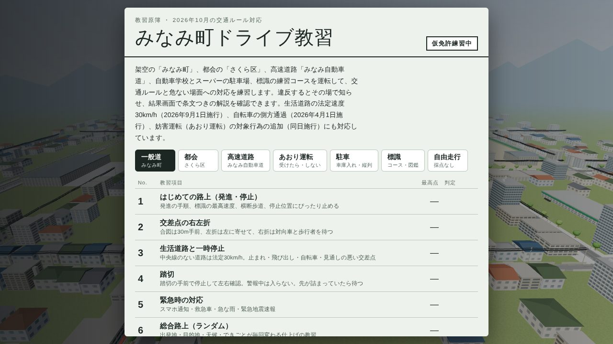
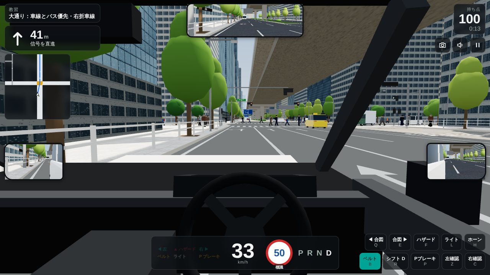
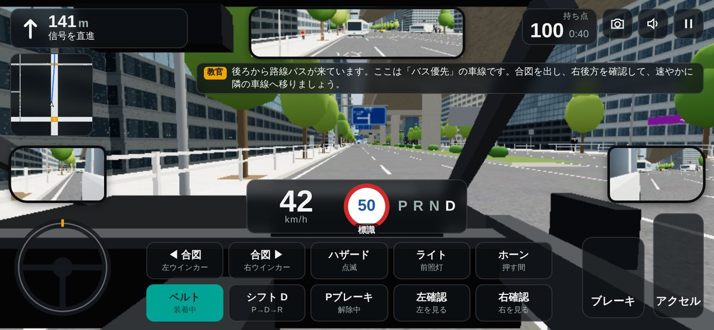

# みなみ町ドライブ教習

ブラウザで遊べる3Dの運転教習ゲームです。架空の町「みなみ町」、都会の「さくら区」、高速道路「みなみ自動車道」を走り、日本の交通ルールにそって採点されます。違反するとその場で知らせ、結果画面で条文つきの解説を確認できます。

PC（キーボード）と、スマートフォン・タブレット（タッチ操作）に対応しています。インストールは要りません。







## 遊び方

公開したページをブラウザで開き、教習を選ぶだけです。ベスト記録と設定は、そのブラウザの中（localStorage）に保存されます。

### キーボード（PC）

| キー | 操作 |
|---|---|
| W / ↑ | アクセル |
| S / ↓ | ブレーキ（長押しで強く） |
| Space | 急ブレーキ |
| A・D / ←・→ | ハンドル |
| Q / E | 左・右の合図（ウインカー） |
| F | ハザード |
| H | クラクション |
| L | ライト |
| B | シートベルト |
| R | シフト（D⇔R） |
| P | パーキングブレーキ |
| Z / C | 左・右を見る（シフトがRのときは後ろを見る） |
| V | 視点切替 |
| Esc | 一時停止 |
| G | 怒鳴る（特殊モードだけ。採点には影響しません） |

設定の「画質」で、路面の凹凸・塗装のつや・雲・影のある「高」と、軽い「低」などを選べます（既定は自動。再読み込み後に反映）。

マウスのドラッグで周りを見回せます。

### スマートフォン・タブレット

- 左下の丸がハンドル、右下が［アクセル］と［ブレーキ］です。
- 次に押すボタンが黄色く光ります。発進前は、光ったボタンを順番にタップします。
- はじめて運転するときは、画面で操作ガイドが出ます。一時停止メニューから見直せます。
- 特殊モードでは、速度計の横に［怒鳴る］ボタンが出ます（採点には影響しません）。

## 収録している教習（26）と特殊モード

| 分類 | 教習 |
|---|---|
| 一般道（みなみ町） | はじめての路上（発進・停止）／交差点の右左折／生活道路と一時停止／踏切／緊急時の対応／総合路上（ランダム） |
| 高速道路（みなみ自動車道） | 料金所から本線へ合流／追越しとトンネル／出口と料金所／落下物・渋滞・故障のとき |
| 都会（さくら区） | 大通り：車線とバス優先・右折車線／駅前：スクランブル交差点と路上の危険／夜の都会：バス停と横断者 |
| 駐車 | 方向変換（車庫入れ）／縦列駐車／スーパーの駐車場（バック駐車）／路上で止めてよい場所 |
| 標識 | 規制標識の道（61種類）／警戒・指示標識の道（40種類）／案内・補助標識の道（90種類）。ほかに標識図鑑とクイズ |
| あおり運転 | あおり運転を受けたら（高速道路）／あおり運転を受けたら（一般道）／あおり運転をしない（自分の運転を見直す） |
| 東京（新宿駅周辺） | 甲州街道：片側3車線の幹線を東へ／明治通り：新宿三丁目から北へ（実在の地図データ（OpenStreetMap・PLATEAU）から作った道路網と建物。店名・看板は架空） |
| 自由走行（採点なし） | みなみ町／みなみ自動車道／さくら区／東京・新宿 |
| 特殊モード | 逆走車と突然の横断（前から逆走してくる車、横断歩道のない所を急に渡ってくる女性やお年寄りに対処する。起きる場所と順番は毎回変わる。この教習だけ「怒鳴る」ボタンが使える） |

## GitHub Pages で公開する

1. GitHub で新しいリポジトリを作ります（公開範囲は Public）。
2. このフォルダの中身をすべてアップロードします。リポジトリの「Add file」→「Upload files」に、フォルダの中身をまとめてドラッグし、「Commit changes」を押します。
3. リポジトリの「Settings」→ 左の「Pages」を開き、「Build and deployment」の「Source」で「Deploy from a branch」を選びます。Branch は「main」、フォルダは「/ (root)」にして「Save」を押します。
4. 少し待つと、`https://<ユーザー名>.github.io/<リポジトリ名>/` で遊べるようになります。

GitHub Free では、Pages を使えるのは Public のリポジトリだけです。有料プランで Private のリポジトリから公開した場合も、公開されたページはインターネット上の誰でも見られます。

## 手元で遊ぶ・改造する

- `index.html` をブラウザで開くだけでも遊べます。three.js とフォントをネットから読み込むため、インターネット接続が必要です。車の3Dモデル（`assets/`）は Web サーバーで配信したときだけ読み込まれ、`index.html` を直接開いたときや読み込めないときは、プログラムで生成した車の形で動きます。
- 車の3Dモデルを作り直すには、Blender の Python モジュール（`pip install bpy`）と gltfpack（`cd tools/cars && npm install`）を入れて、`tools/cars/build.sh` を実行します（`tools/cars/gen_cars.py` が形を作り、gltfpack が圧縮して `assets/cars/` に置きます）。
- 東京・新宿駅周辺の地図は、実在の地図データから作っています。`tools/shinjuku/extract_area.py` で OpenStreetMap と国土交通省 PLATEAU から必要な範囲を抜き出し（`tools/shinjuku/README.md`）、`tools/shinjuku/build_map.py` でゲーム用の `assets/maps/shinjuku.json` に変換します。この地図は Web サーバーで配信したときだけ使えます（`index.html` を直接開いたときは案内が出ます）。出典：© OpenStreetMap contributors（ODbL）、国土交通省 Project PLATEAU 3D都市モデル（新宿区 2025、CC BY 4.0 等）。実在の店名・ロゴは使っていません。
- 改造するときは `src/` のファイルを編集し、`python3 build.py` を実行してください。`index.html` が作り直されます（Python 3 の標準機能だけで動きます）。
- 手元の Web サーバーで確かめる場合は、このフォルダで `python3 -m http.server 8000` を実行し、`http://localhost:8000/` を開きます。

## ファイル構成

```
index.html      公開用のゲーム本体（これ1つで動きます。assets/ があると車が3Dモデルになります）
assets/cars/    車の3Dモデル（glb。meshopt で圧縮。tools/cars で生成）
assets/lib/     3Dモデルの読み込み部品（three.js r128 の GLTFLoader と meshopt のデコーダー）
assets/ogp.jpg  SNS で共有したときに出る画像（OGP / Twitter Card。1200×630。差し替えたら build.py の OGP_VER を上げる）
assets/maps/    東京・新宿駅周辺の地図データ（道路網・建物・線路・緑地。tools/shinjuku で生成。約1MB、起動後に裏で読み込み）
build.py        src/ から index.html を作るスクリプト
src/head.html   画面の部品と見た目（CSS）
src/js/         ゲームの処理（ファイル名の順につなげて index.html に入れます）
tools/cars/     車の3Dモデルの生成（Blender の Python モジュール）と圧縮（gltfpack）
tools/shinjuku/ 新宿駅周辺の地図データの作成（OpenStreetMap と PLATEAU から抜き出し → ゲーム用に変換）
screenshots/    この README の画像
```

`src/js/` のおもなファイルです。

| ファイル | 内容 |
|---|---|
| 00_text.js | 違反の解説・条文・出典などの文章 |
| 00b_signdata.js | 道路標識の一覧（標識令 別表第一） |
| 01b_signart.js、01c_signart2.js | 標識の絵（キャンバスで描画） |
| 02_net.js、02b〜02g_map_*.js、02h_netpoly.js | 道路網と地図（町・高速道路・都会・駐車の練習場・標識コース・新宿駅周辺）。02h は斜めに道路が入る多角形の交差点（新宿） |
| 03a〜03g_*.js | 路面・建物・小物・沿道の3Dモデル（03g は新宿：PLATEAU の建物の押し出し・線路・緑地） |
| 04_models.js、05_signals.js | 車・歩行者・電車、信号機・踏切 |
| 06a_traffic.js、06b_peds.js | ほかの車と歩行者の動き |
| 07_player.js、07b_view.js | 自分の車の動き、カメラと描画・ミラー |
| 08a〜08e_judge*.js | 採点（違反の判定） |
| 09_events.js、09b・09c_events_*.js | 緊急車両・地震・故障などのできごと |
| 10_audio.js | 効果音 |
| 11a〜11d_*.js | 画面表示・メニュー・「どうする？」カード・標識図鑑 |
| 12_stages.js、12b〜12h_*.js | 各教習の内容（12h は東京・新宿） |
| 13_main.js | 起動・進行・メインループ |
| 14_autopilot.js | 自動運転（お手本・動作確認用） |

## 使用しているもの

- [three.js](https://threejs.org/) r128（MIT License）— cdnjs から読み込み
- フォント：BIZ UDPGothic、Dela Gothic One、Saira Condensed（いずれも SIL Open Font License）— Google Fonts から読み込み
- 車・建物・標識などの3Dモデルと絵は、すべてコードで描いています。外部の画像やモデルのファイルは使っていません。

## 注意

- 交通ルールは、学習用に単純化している部分があります。実際の運転や試験では、警察庁・都道府県警察・教習所などの公式の情報を確認してください。ゲーム内の「このゲームについて」に、根拠にした資料と、単純化している点をまとめています。
- ゲーム内の交通ルールは、2026年10月時点の情報をもとにしています。
- 地名・道路・店名はすべて架空です。
